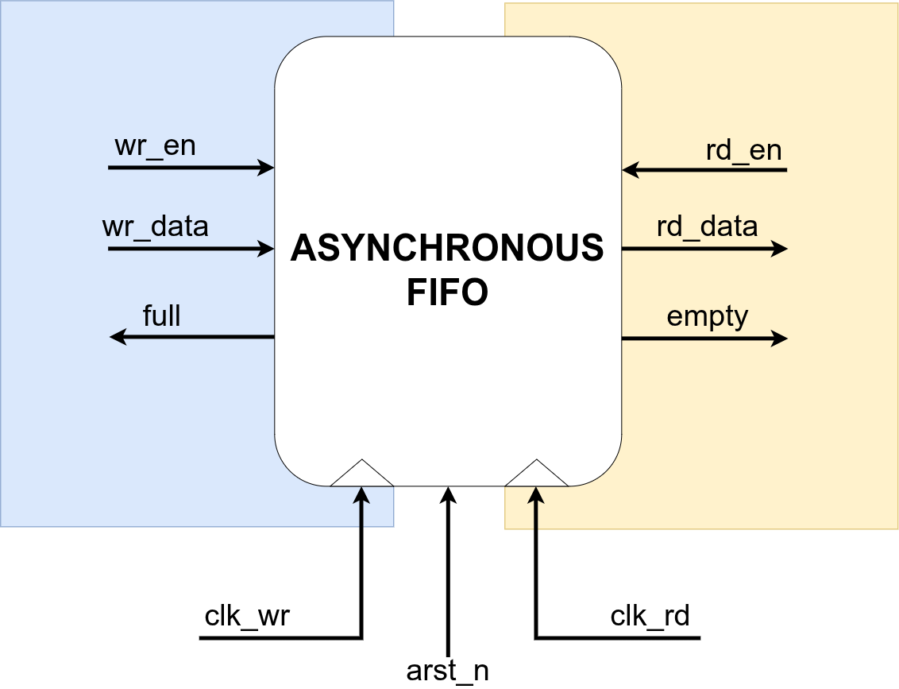

<div align="center">

# Asynchronous FIFO

**A parameterized dual-clock FIFO with Gray-coded clock-domain crossing, two-flop synchronizers, and self-checking verification.**

[](rtl/)
[](https://github.com/vohoangnguyennnn/Asynchronous-FIFO/actions/workflows/rtl-lint.yml)
[](docs/README.md)
[](LICENSE)

</div>

<p align="center">
  
</p>

## Overview

This repository implements an asynchronous FIFO in synthesizable SystemVerilog.
It transfers ordered data between independent write and read clock domains while
keeping all multi-bit pointer comparisons local to their destination domains.

The design uses binary pointers for memory addressing and converts them to Gray
code before clock-domain crossing. Because only one Gray-code bit changes between
adjacent pointer values, each pointer can be sampled through a two-flop
synchronizer without exposing a multi-bit binary transition directly to the
other clock domain.

### Highlights

- Independent write and read clocks with a common active-low reset request
- Asynchronous reset assertion and domain-local synchronous deassertion
- Parameterized data width and FIFO depth
- Dual-port storage with first-word-fall-through read behavior
- `ADDR_WIDTH + 1`-bit pointers for address tracking and wrap detection
- Binary-to-Gray conversion before crossing clock domains
- Two-flop synchronizers in both CDC directions
- Full and empty protection for rejected overflow and underflow requests
- Domain-local registered `full` and `empty` flags computed from next pointers
- Self-checking testbench with a queue-based scoreboard
- Directed boundary tests, concurrent random traffic, and pointer wrap-around
- Bound SystemVerilog assertions for pointer, flag, boundary, and Gray-code invariants
- Portable synchronizer attributes with Quartus-specific MTBF recognition
- Reproducible TimeQuest flow for CDC delay, Gray-bus skew, and metastability reports

## Architecture

The FIFO is split into write-domain logic, read-domain logic, dual-port memory,
and two CDC synchronizer paths.

| Write clock domain | Clock-domain crossing | Read clock domain |
| --- | --- | --- |
| Accepts writes when `wr_en && !full` | Synchronizes `wr_gray` into `clk_rd` | Accepts reads when `rd_en && !empty` |
| Advances `wr_bin` and `wr_gray` | Synchronizes `rd_gray` into `clk_wr` | Advances `rd_bin` and `rd_gray` |
| Registers `full` from the next write pointer and synchronized read state | Uses two destination-clock flip-flops | Registers `empty` from the next read pointer and synchronized write state |
| Writes memory at the binary write address | Gray encoding limits adjacent changes to one bit | Reads memory at the binary read address |

The common `arst_n` input flushes the complete FIFO. It asserts both domains
asynchronously, while separate reset synchronizers release the write and read
logic on their respective clocks. Requests must remain inactive until reset
release and pointer synchronization have converged.

The local status comparisons are:

```systemverilog
empty_next = (rd_gray_next == wr_gray_sync_to_rd);

full_next = (wr_gray_next ==
             (rd_sync_gray_to_wr ^ FULL_COMPARE_MASK));
```

Equal Gray pointers indicate an empty FIFO. A full FIFO is detected by matching
the lower Gray-pointer bits while inverting the two most-significant bits of the
synchronized read pointer, which represents a separation of one complete FIFO
depth. Both comparisons use the pointer value after the currently accepted
transaction, allowing `full` and `empty` to be registered without asserting one
cycle late.

## Parameters

| Parameter | Default | Description |
| --- | ---: | --- |
| `DATA_WIDTH` | `8` | Width of each stored data word |
| `ADDR_WIDTH` | `5` | Number of address bits; must be at least 1 |
| FIFO depth | `2**ADDR_WIDTH` | Number of stored words, always a power of two; 32 entries by default |
| Pointer width | `ADDR_WIDTH + 1` | Address plus wrap-tracking bit |

The verification environment overrides `ADDR_WIDTH` to `4`, producing a
16-entry FIFO for the tested configuration.

## Interface

| Signal | Direction | Clock domain | Description |
| --- | --- | --- | --- |
| `clk_wr` | Input | Write | Write-domain clock |
| `arst_n` | Input | Both | Common active-low asynchronous reset request; deassertion is synchronized per domain |
| `wr_en` | Input | Write | Write request; accepted only while `full == 0` |
| `wr_data` | Input | Write | `DATA_WIDTH`-bit input data |
| `full` | Output | Write | Prevents writes when the FIFO has no free entry |
| `clk_rd` | Input | Read | Read-domain clock |
| `rd_en` | Input | Read | Read request; accepted only while `empty == 0` |
| `rd_data` | Output | Read | Current word at the read pointer |
| `empty` | Output | Read | Prevents reads when no valid entry is available |

`rd_data` uses first-word-fall-through behavior and is only meaningful while
`empty == 0`. The memory itself is not reset, so an unknown `rd_data` value while
the FIFO is empty is expected in simulation.

### Implementation and integration notes

- `rd_data` is an asynchronous (combinational) read of the memory array, so
  synthesis infers LUT/distributed RAM rather than block RAM.
- The `mem` to `rd_data` path is a clock-domain crossing that is safe by
  protocol, not by synchronizer: an entry is written at least two `clk_rd` edges
  before `empty` deasserts for it, and it is not overwritten until the read
  pointer has moved past it. When this FIFO is integrated into a larger design,
  this path needs system-level constraints from the integrator.

## Verification

The self-checking testbench drives requests on falling clock edges and observes
accepted transactions on rising edges to avoid simulation races. A shared queue
scoreboard records every accepted write and checks every accepted read for
ordering and data integrity.

| Test | What it verifies |
| --- | --- |
| Reset state | Async assertion, domain-local synchronous release, flags, and pointer initialization |
| Directed fill and drain | FIFO ordering across every entry |
| Overflow attempt | A blocked write does not advance the write pointer |
| Underflow attempt | A blocked read does not advance the read pointer |
| Concurrent random traffic | Independent-clock operation under simultaneous activity |
| Pointer wrap-around | Correct behavior beyond one complete FIFO depth |
| Bound SVA checker | Reset state, next-state equations, accepted/rejected transactions, registered flags, Gray coherence and one-bit transitions |
| Cover properties | Final write/read reaching full/empty and write/read pointer wrap-around |

Tested with Questa Altera Starter FPGA Edition 2025.2 using an 8-bit,
16-entry FIFO, a 100 MHz write clock, and an approximately 71 MHz read clock.
The fixed-seed regression completed with all 207 accepted writes matched by 207
accepted reads:

```text
PASS: reset state
PASS: fill/drain ordering and boundary protection
PASS: concurrent random traffic and pointer wrap-around
TEST PASSED - writes=207 reads=207
Errors: 0, Warnings: 0
```

[](docs/README.md)

The detailed report contains the complete test configuration, annotated
QuestaSim waveforms, compilation evidence, and regression results. Waveform
images are intentionally kept out of this top-level README.

GitHub Actions runs Verilator lint (`-Wall`) on the synthesizable RTL for every
push and pull request to `main`. The complete behavioral regression remains a QuestaSim
flow because the testbench uses simulator features that are not part of the
open-source CI job.

> RTL simulation validates functional CDC behavior but does not model analog
> metastability. The included TimeQuest flow provides a reproducible reference
> implementation, but production sign-off still requires constraints and I/O
> budgets for the actual target technology and integration environment.

## Run the simulation

### Requirements

- QuestaSim or Questa Altera Starter FPGA Edition
- GNU Make
- `vlib`, `vlog`, `vsim`, and `vdel` available in `PATH`

From the repository root:

```bash
# Compile RTL and the testbench
make -C sim compile

# Run the complete regression in terminal mode
make -C sim sim

# Open QuestaSim with preconfigured signals
make -C sim gui

# Remove the compiled work library
make -C sim clean
```

## Run the CDC/STA reference flow

### Requirements

- Intel Quartus Prime with Cyclone V device support
- `quartus_sta` and `quartus_sh` from the same installation

From the repository root:

```bash
quartus_sta -t scripts/run_sta.tcl
```

The script creates an ignored project under `build/quartus_sta`, performs
synthesis and fitting, reads `constraints/async_fifo.sdc`, and writes reports
for clocks, CDC transfers, exceptions, Gray-bus skew, net delay, metastability,
and unconstrained paths under `build/quartus_sta/reports`.

The default Cyclone V part is only a reference analysis vehicle. Override it
without changing the repository:

```bash
ASYNC_FIFO_STA_FAMILY="Cyclone V" \
ASYNC_FIFO_STA_DEVICE="5CEFA4F23C6" \
quartus_sta -t scripts/run_sta.tcl
```

External input and output paths remain unconstrained intentionally because this
module-level project does not define a board or system-level I/O budget.

## Repository structure

```text
.
├── .github/
│   └── workflows/rtl-lint.yml  # Automated Verilator RTL lint
├── rtl/
│   ├── async_fifo.sv       # Top-level FIFO, memory, and flag logic
│   ├── gray_counter.sv     # Binary and Gray-code pointer counter
│   ├── reset_sync.sv       # Async-assert, synchronous-deassert reset synchronizer
│   └── sync_2ff.sv         # Parameterized two-flop synchronizer
├── verification/
│   ├── async_fifo_sva.sv   # Bound assertions and functional cover properties
│   └── async_fifo_tb.sv    # Self-checking traffic and scoreboard
├── sim/
│   ├── Makefile            # Compile, simulation, GUI, and clean targets
│   └── questa.do           # QuestaSim setup and waveform configuration
├── constraints/
│   └── async_fifo.sdc      # TimeQuest clocks and targeted CDC constraints
├── scripts/
│   └── run_sta.tcl         # Reproducible Quartus synthesis, fit, and STA flow
├── docs/
│   ├── images/             # Architecture, synthesis, and simulation evidence
│   └── README.md           # Detailed verification and CDC/STA evidence report
├── LICENSE
└── README.md
```

## License

This project is released under the [MIT License](LICENSE). Copyright © 2026
Vo Hoang Nguyen.
