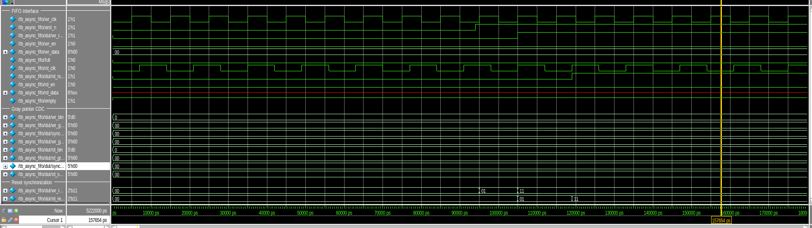
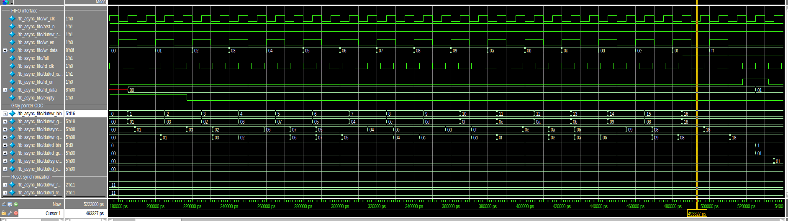
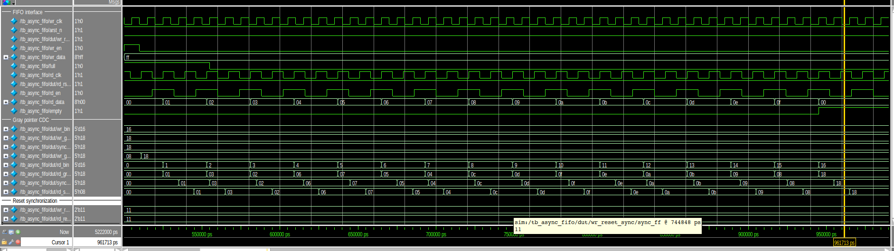
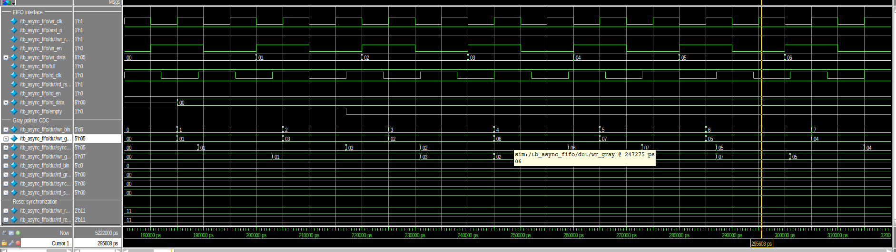
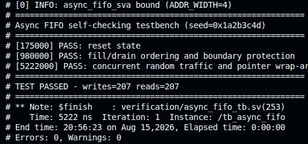

# Asynchronous FIFO Verification and CDC/STA Report

This report presents the verification evidence for the parameterized
dual-clock asynchronous FIFO. The design architecture and basic usage are
described in the repository-level [`README.md`](../README.md).

## 1. Design under test

The FIFO transfers ordered data between independent write and read clock
domains. Binary pointers address the memory locally, while Gray-coded pointers
cross the clock boundary through two-stage synchronizers. Full and empty flags
are calculated from next-pointer values and registered in their respective
clock domains.

The common active-low reset request uses asynchronous assertion and independent
synchronous release in each destination domain. This prevents reset removal
from occurring at an uncontrolled point relative to either clock.

### Reference configuration

| Setting | Simulation | STA reference |
| --- | --- | --- |
| Data width | 8 bits | 8 bits |
| `ADDR_WIDTH` | 4 | 5 (RTL default) |
| FIFO depth | 16 entries | 32 entries |
| Pointer width | 5 bits | 6 bits |
| Write clock | 100 MHz (`10 ns`) | `10 ns` (SDC default) |
| Read clock | Approximately 71 MHz (`14 ns`) | `14 ns` (SDC default) |
| Randomized writer cycles | 400 | n/a |
| Random seed | `32'h1A2B_3C4D` | n/a |
| Tool | Questa Altera Starter FPGA Edition 2025.2 | Quartus Prime Standard 25.1 |
| Target | n/a | Cyclone V `5CEFA4F23C6` |

The testbench overrides `ADDR_WIDTH` to 4, while `scripts/run_sta.tcl`
synthesizes `async_fifo` with its default parameters.

The testbench drives requests on falling clock edges and observes accepted
transactions on rising edges. A queue-based scoreboard records each accepted
write and compares it with every accepted read.

## 2. Reset-domain crossing verification

The reset test checks that:

- `arst_n` asserts both internal resets asynchronously.
- `wr_rst_n` deasserts only on a rising edge of `wr_clk`.
- `rd_rst_n` deasserts only on a rising edge of `rd_clk`.
- Each reset passes through two destination-clock stages before release.
- Both pointers return to zero, `full` clears, and `empty` asserts.



The waveform shows `arst_n` releasing away from both clock edges. The
write- and read-domain synchronizer shift registers then progress independently,
causing `wr_rst_n` and `rd_rst_n` to release on their own clock edges. The
different release times are intentional and demonstrate correct RDC handling.
The testbench task `apply_reset` checks that each internal reset remains
asserted after the first destination-clock edge and releases on the second.

## 3. Directed FIFO boundary verification

### 3.1 Fill, full, and overflow protection

The testbench writes `8'h00` through `8'h0F`, filling every FIFO entry. It then
attempts one additional write using `8'hFF`.



Each accepted transaction advances `wr_bin` and updates `wr_gray`. The
registered `full` flag asserts after the final free entry is consumed. During
the following overflow attempt, `wr_en` is asserted while `full` is high, but
the write pointer remains unchanged.

### 3.2 Drain, empty, and underflow protection

All 16 entries are read and checked against the scoreboard. After the final
valid read, the testbench attempts one additional read.



Accepted reads advance `rd_bin` and return the stored sequence in FIFO order.
The registered `empty` flag asserts after the last valid entry is consumed. The
underflow request does not advance the read pointer or remove data from the
scoreboard. An unknown `rd_data` value while `empty` is high is legal because
the inferred memory is intentionally not reset.

## 4. Gray-pointer clock-domain crossing

Only Gray-coded pointers cross between the two clock domains. The first
synchronizer stage may sample an asynchronous transition; only the second stage
is exposed to destination-domain flag logic.



For each accepted write, adjacent `wr_gray` values differ by exactly one bit.
The read-domain `sync_wr_to_rd.ff1` stage samples the asynchronous Gray pointer,
and the second stage exposes it one `rd_clk` edge later as
`wr_gray_sync_to_rd`. The reverse
path follows the same structure for `rd_gray`. This synchronization latency is
expected and prevents combinational destination logic from using the
metastability-prone first stage.

## 5. Concurrent randomized traffic and pointer wrap-around

The writer and reader operate concurrently with independently randomized
enables. After the writer completes 400 cycles, the remaining entries are
drained. The phase must perform more than one additional FIFO depth of writes,
ensuring pointer wrap-around is exercised.

The randomized phase is summarized by the self-checking regression result
rather than an additional dense waveform. Bound cover properties confirm that
both local pointers wrap during the run.

## 6. Assertions and functional coverage

The bound `async_fifo_sva` checker verifies:

- binary/Gray next-state equations and Gray-code coherence;
- zero-or-one-bit Gray transitions for accepted pointer updates;
- stable pointers during rejected overflow and underflow requests;
- registered full and empty equations;
- reset state while each domain-local reset is asserted;
- final transactions reaching full and empty;
- write- and read-pointer wrap-around cover points.

Reset release after two destination-clock edges is checked by the testbench
(`apply_reset`), not by the assertions. The checker is bound externally, keeping
verification logic out of the synthesizable design hierarchy.

## 7. Regression result

The fixed-seed regression completed with every accepted write matched by an
accepted read:

```text
PASS: reset state
PASS: fill/drain ordering and boundary protection
PASS: concurrent random traffic and pointer wrap-around
TEST PASSED - writes=207 reads=207
Errors: 0, Warnings: 0
```



## 8. CDC and static-timing reference analysis

The TimeQuest SDC applies targeted max/min-delay exceptions, per-path net-delay
requirements, and inter-bit maximum-skew constraints to both Gray-pointer CDC
buses. Quartus-specific attributes preserve and identify the pointer and reset
synchronizer chains while other tools retain the portable `ASYNC_REG` marker.

The figures below come from a reference Quartus Prime Standard 25.1 run of the
32-entry configuration (`ADDR_WIDTH = 5`, 6-bit pointers), which is why there
are 12 pointer-synchronizer chains. They can be reproduced with
`scripts/run_sta.tcl`. The full reports are kept as text evidence:
[`metastability.txt`](evidence/metastability.txt),
[`max-skew.txt`](evidence/max-skew.txt), and
[`net-delay.txt`](evidence/net-delay.txt).

| Check | Result |
| --- | --- |
| Synchronizer chains | 14 two-register chains: 12 pointer bits and 2 reset chains |
| Chains without calculated MTBF | 0 |
| Reference design MTBF estimate | Greater than 1 billion years |
| Gray-bus max-skew comparisons | 24, with 0 violations |
| Worst write-to-read skew | `0.914 ns` against `8.000 ns` |
| Worst read-to-write skew | `0.756 ns` against `11.200 ns` |
| Worst reported net delay | `1.599 ns` against `11.200 ns` |

The MTBF value depends on the selected FPGA, placement, operating conditions,
and TimeQuest toggle-rate assumptions. It demonstrates correct synchronizer
recognition in this reference implementation; it is not a technology-independent
silicon guarantee.

External data, enable, status, and reset I/O paths are intentionally reported as
unconstrained. This repository defines a reusable module and does not assume a
board, package, or system-level I/O timing budget.

## 9. Reproducing the evidence

### 9.1 Run the simulation

```bash
# Terminal regression
make -C sim sim

# Interactive GUI with all required waveform signals preloaded
make -C sim gui
```

### 9.2 Save simulation and STA console logs

The repository ignores `*.log`, so use `.txt` when the evidence should be
committed:

```bash
mkdir -p docs/evidence

make -C sim sim 2>&1 | tee docs/evidence/questa-regression.txt

quartus_sta -t scripts/run_sta.tcl 2>&1 \
  | tee docs/evidence/quartus-sta-console.txt
```

The STA flow also writes detailed reports under `build/quartus_sta/reports`.
Copy only the useful reports and rename them to `.txt` if they should be kept in
Git:

```bash
cp build/quartus_sta/reports/metastability.rpt \
  docs/evidence/metastability.txt
cp build/quartus_sta/reports/max_skew.rpt \
  docs/evidence/max-skew.txt
cp build/quartus_sta/reports/net_delay.rpt \
  docs/evidence/net-delay.txt
```

Avoid committing the complete `build/` directory, Quartus databases, WLF files,
or redundant tool-generated reports.

## 10. Scope and limitations

This project verifies FIFO ordering, boundary protection, pointer wrap-around,
reset-domain behavior, and CDC timing constraints for one reference
configuration. RTL simulation cannot model analog metastability, and the
reference FPGA analysis is not a substitute for technology- and
integration-specific CDC, STA, and physical-design sign-off.
